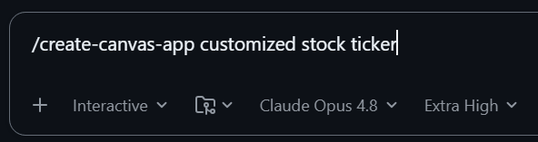
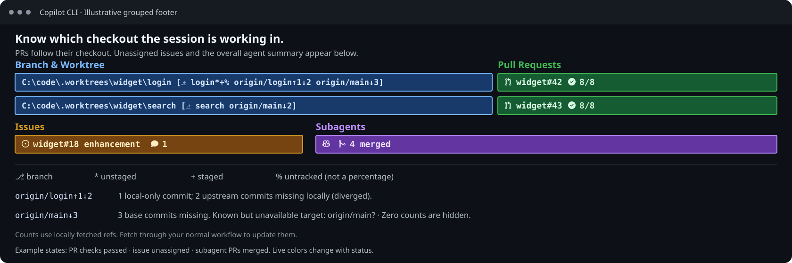
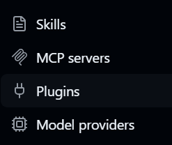
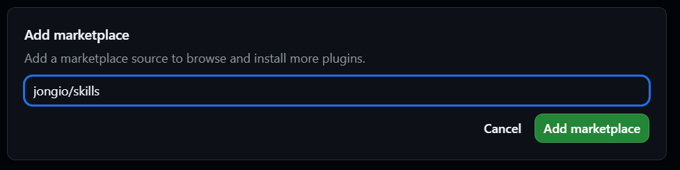
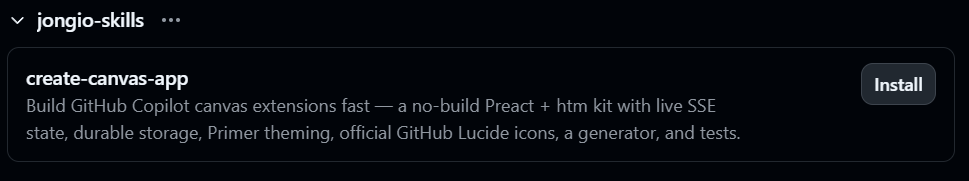
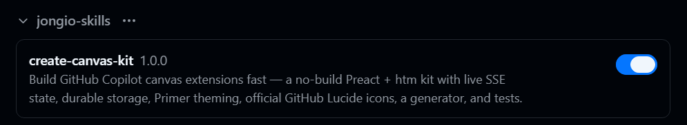

# jongio/skills

[](https://skills.sh/jongio/skills)
[](https://jongio.github.io/skills/)

Jon Gallant's collection of portable skills and terminal statusline extensions
for AI coding agents — works with
[GitHub Copilot](https://docs.github.com/copilot) (App, CLI, VS Code, and
coding agent), Claude Code, Codex, Cursor, Gemini CLI, and any host that
supports [Agent Plugins 1.0](https://agent-plugins.org/plugin-authors/manifest)
or the [`SKILL.md`](https://github.com/vercel-labs/skills) format. Each skill
lives in its own self-contained folder under [`skills/`](skills/) and can be
installed individually or all at once as one plugin.

[**Live Catalog**](https://jongio.github.io/skills/) &middot;
[**Skills**](#skills) &middot;
[**CLI Statuslines**](#copilot-cli-statusline-extensions) &middot;
[**Install**](#install) &middot;
[**Supported Hosts**](#app-and-editor-support) &middot;
[**Versioning**](#versioning) &middot;
[**Dependency Policy**](#dependency-maintenance) &middot;
[**Layout & CI**](#layout)

## Skills

| Skill | What it does |
|---|---|
| [`create-canvas-app`](skills/create-canvas-app/) | Build GitHub Copilot App canvas extensions fast — a no-build Preact + htm kit with live SSE state, durable storage, Primer theming, official GitHub Lucide icons, deep links into the app, a generator, and an installable skill. |
| [`create-gh-pages-site`](skills/create-gh-pages-site/) | Scaffold a working GitHub Pages site from a vetted template (static, Astro, React + Vite, Eleventy, Jekyll, or a skills catalog) into your current repo by default — injects the correct base path for the target repo, wires the official GitHub Actions Pages deploy workflow, sets the repo's Website link, and shows how to enable Pages. |
| [`create-skill`](skills/create-skill/) | Create and register a complete portable agent skill with focused instructions, deterministic tests, Vally evals, catalog metadata, and optional validated thumbnail art from a built-in or user-described provider. |
| [`create-skills-repo`](skills/create-skills-repo/) | Create or safely upgrade a cross-agent skills marketplace repository with every supported manifest, Vally, secure CI, Dependabot, a functional starter skill, and an optional GitHub Pages catalog. |
| [`repo-ready`](skills/repo-ready/) | Scaffold and maintain the standard community health files every GitHub repository needs (.gitignore, LICENSE, CONTRIBUTING, issue templates, CI workflows, dependabot, and more). Two modes: init (interview + scaffold) and update (scan for gaps). |
| [`naming-is-hard`](skills/naming-is-hard/) | Interactive naming assistant for projects, CLIs, and products. Profiles what you're building, generates diverse candidate names, learns your preferences as you react, and validates finalists against real availability (domains, GitHub, npm/PyPI/crates/RubyGems/NuGet, social handles) plus a trademark and existing-business screen. Every finalist lands a verdict: Deal Breaker, It's Complicated, or Perfect Match. |
| [`eli5`](skills/eli5/) | Explain the code, error, design, or idea already in context using plain language, a useful analogy, the proper grown-up terms, and an honest note about where the analogy stops working. |
| [`dns-doctor`](skills/dns-doctor/) | Audit DNS delegation, records, DNSSEC, CAA, web routing, TLS, CDN behavior, mail authentication, takeover exposure, and zone hygiene, then apply exact provider changes only after explicit user approval. |
| [`deps-doctor`](skills/deps-doctor/) | Audit, update, and secure dependencies across npm, pnpm, Yarn, pip, Pipenv, Poetry, uv, Go, Cargo, Bundler, Composer, NuGet, Maven, Gradle, Swift, pub, and Hex, plus Docker base images, GitHub Actions, Terraform, and dev container features. Finds outdated, unused, and undeclared packages, ranks vulnerabilities by exploitation evidence, screens supply-chain risk, withholds releases too new to have been vetted, fixes breaking changes forward instead of rolling back, and never opens an empty dependency pull request. |
| [`git-tidy`](skills/git-tidy/) | Content-aware Git work triage across branches, worktrees, stashes, remote refs, tags, remotes, artifacts, ignored tracking, large blobs, and maintenance. Leads with plain decisions and concrete actions while exact proof stays available on demand; analysis is read-only and every action requires separate approval. |
| [`test-doctor`](skills/test-doctor/) | Audit test correctness, coverage, reliability, and maintenance; optionally repair material gaps without gaming the suite. |
| [`pr`](skills/pr/) | A concise checklist workflow for taking changes from local commit and preflight checks through PR submission, review resolution, CI monitoring, and merge. |
| [`go`](skills/go/) | Plan, test, and implement the current context, then hand verified changes to pr for delivery and merge. |
| [`retro`](skills/retro/) | Close out a session with an evidence-backed task and feedback audit, source-skill improvements, and safely approved branch and worktree cleanup. |
| [`doc-doctor`](skills/doc-doctor/) | Compare changed or requested documentation against actual code, validate local links, anchors, images, examples, and frontmatter, and fix material gaps within scope. |
| [`backlog-groom`](skills/backlog-groom/) | Groom GitHub backlogs across issue and source repositories, with or without Projects, using scoped evidence and approved changes. |
| [`refactor`](skills/refactor/) | Plan behavior-preserving refactoring with explicit scope, depth and risk choices. |
| [`skill-doctor`](skills/skill-doctor/) | Learn from recent session feedback and trim skill bloat, with cached audits, a dedicated worktree, and one improvement PR. |
| [`ci-doctor`](skills/ci-doctor/) | Diagnose, check, and optimize GitHub Actions workflows with stateless ETag-cached checkups, main failure root-cause repair in isolated worktrees, and workflow cost/security hardening. |
| [`session-statusline`](skills/session-statusline/) | Manage only the current session's active statusline pills and clear entries without deleting work or changing enabled components. |
| [`create-session-board-canvas`](skills/create-session-board-canvas/) | Show a live session progress board with canonical tasks, blockers, and primary/subagent updates. |
| [`repo-maintain`](skills/repo-maintain/) | Run an end-to-end repository maintenance pass across governance, dependencies, security, refactoring, coverage, docs, skills, and evals on a single rolling branch. |
| [`eval-doctor`](skills/eval-doctor/) | Audit, author, and harden AI skill and prompt evaluations with Vally, github/evals, deterministic graders, and safe github/evals-action CI workflows. |
| [`secops-doctor`](skills/secops-doctor/) | Audit repository and application security across OWASP/STRIDE, secrets, workflows, containers, and Cloudflare with Public Repo Stealth Mode. |
| [`release-doctor`](skills/release-doctor/) | Verify post-merge release readiness, unreleased commits, semver recommendations, and cross-manifest version parity before cutting a release. |

**How the delivery workflow skills fit together:** triage issues with
[`backlog-groom`](skills/backlog-groom/), plan and implement with
[`go`](skills/go/) (or scope structural changes with
[`refactor`](skills/refactor/)), audit tests and docs with
[`test-doctor`](skills/test-doctor/) and [`doc-doctor`](skills/doc-doctor/),
ship and merge with [`pr`](skills/pr/), diagnose and optimize CI with
[`ci-doctor`](skills/ci-doctor/), and close out or refine skills with
[`retro`](skills/retro/), [`skill-doctor`](skills/skill-doctor/), and
[`git-tidy`](skills/git-tidy/). Track live progress in the terminal footer with
[`session-statusline`](skills/session-statusline/) or in a side-panel board
with [`create-session-board-canvas`](skills/create-session-board-canvas/).

A skill is invoked straight from the Copilot composer &mdash; here `create-canvas-app`
turns a one-line prompt into a working canvas:



## Copilot CLI Statusline Extensions

This plugin also ships four composable terminal statuslines for GitHub Copilot CLI under [`extensions/`](extensions/) (exposed to Agent Plugins 1.0 hosts via `com.github.copilot/extensions/`):

| Extension | What it shows |
|---|---|
| [`pr-statusline`](extensions/pr-statusline/) | Open session PRs on GitHub and follow checks, conflicts, approvals, and review threads. Background-agent PRs can appear in the agent summary; confirmed merged pills clear on your next message after the merge, even if detection is delayed. |
| [`issue-statusline`](extensions/issue-statusline/) | Separate clickable pill for each GitHub issue the active session is working on: priority or bug labels, linked open PR indicator, assignee handle, comment count, and a purple `Closed` badge that dismisses on your next prompt. |
| [`subagent-statusline`](extensions/subagent-statusline/) | Overall session subagent counts (`starting`, `exploring`, `in PR`, `merged`, and `failed`). Settled counts dismiss on the next real user message after detection without hiding ongoing agents. Use `/tasks` to inspect individual agents. |
| [`worktree-statusline`](extensions/worktree-statusline/) | Checkout-grouped rows with full paths, native `[⎇ branch*+%]` labels, upstream `↑`/`↓` divergence counts and missing base commits, followed by related PRs and issues. Hides Copilot's own checkout label and empty historical rows; supports detached HEADs and one overall subagent summary. |



With **Branch and Worktree** enabled, each checkout row starts with a blue,
non-linked `path [⎇ branch*+%]` pill, followed by its PRs and linked issues.
`*` means unstaged changes, `+` staged changes, and `%` untracked files (not a
percentage). For example, `origin/feat/login↑1↓2` means one local-only commit
and two upstream commits missing locally; `origin/main↓3` means three missing
base commits. Zero counts are hidden, and `target?` means a known comparison is
unavailable. Counts use locally fetched refs, not a background network fetch.
The base is the matched PR's target, otherwise the remote default branch;
it is not a guess about where the branch was originally created.
Copilot's own checkout label is hidden; one overall subagent
summary appears below the checkout rows. See the
[worktree guide](extensions/worktree-statusline/README.md) for association and
visibility rules. Disabling worktree grouping restores horizontal composition.

Installing `statuslines@jongio-skills` (statuslines only) or `jongio-skills@jongio-skills` (all skills and statuslines) from the `jongio/skills` marketplace auto-registers the statuslines and opens an interactive checkbox picker on first session start. Use `/session-statusline setup` (or the compatibility alias `/statusline-setup`) to toggle **Pull Requests**, **GitHub Issues**, **Subagents**, and **Branch and Worktree** anytime. `/session-statusline refresh` forces fresh tracked data; `/session-statusline clear` dismisses this session's entries without changing enabled components or deleting transcripts. The full plugin also includes the [`session-statusline`](skills/session-statusline/) skill: ask "clear the footer pills" or remove one PR, issue, or agent. All PR and issue enrollment is explicit through session tools or commands; shell commands, GitHub responses, and references never create pills. Actual session agent launches remain automatic. See [session recovery and setup](extensions/pr-statusline/README.md#session-recovery-and-setup), including the collector restart and legacy-entry reset after upgrading. Or run the standalone setup script:

```text
# Install just the statuslines (no skills) in Copilot CLI:
/plugin marketplace add jongio/skills
/plugin install statuslines@jongio-skills
```

```powershell
# Windows (PowerShell one-liner)
irm https://raw.githubusercontent.com/jongio/skills/main/install-statusline.ps1 | iex
```

```bash
# macOS & Linux (Bash one-liner)
curl -fsSL https://raw.githubusercontent.com/jongio/skills/main/install-statusline.sh | bash
```

```sh
# Or from a local checkout (interactive picker or explicit flags):
node ./scripts/setup-statusline.mjs
node ./scripts/setup-statusline.mjs --all
node ./scripts/setup-statusline.mjs --prs --issues --subagents --worktrees
```

> **Note:** Terminal statuslines, `/session-*` slash commands, and Windows
> Terminal attention alerts are **Copilot CLI–only** (they automatically no-op
> when a session is hosted in the GitHub Copilot app). SDK extension commands
> require experimental features enabled once with `/settings experimental on`,
> followed by `/restart` in existing CLI windows.

**Custom session names:** run `/session-statusline name API migration`, or ask
the `session-statusline` skill to "name this session API migration". The label
appears first in that session's footer and persists on resume. Use
`/session-statusline name` to show it or `/session-statusline clear-name` to
remove it. Clearing tracked pills preserves the name.

**Windows Terminal attention alerts** are also available, independently of the
footer rows. Run `/session-attention both` to enable a pulsing border and
background wash until that session's window gets focus, or
`/session-attention preview` to try the appearance without enabling it.
Alerts are off by default. See [window attention settings and behavior](extensions/pr-statusline/README.md#windows-terminal-attention-alerts).

**Optional CI/PR daemon timeline bridge:** the
[`daemon-notifications`](extensions/daemon-notifications/) extension logs
background [`ci-doctor`](skills/ci-doctor/) and [`pr`](skills/pr/) watcher events
into the active Copilot CLI session timeline without calling a model or
starting repairs. Enable it with `node scripts/setup-statusline.mjs --notifications`,
run `/daemon-notifications subscribe <watcher>`, and pass the returned file to
the watcher with `--events-file`.

## Install

<a id="add-as-a-marketplace-or-install-as-a-plugin"></a>

### Option 1: Copilot Plugin Marketplace (Recommended)

`jongio/skills` plugs directly into the GitHub Copilot **plugin** system (works in both
the Copilot app and the [Copilot CLI](https://docs.github.com/copilot/how-tos/copilot-cli)).
The repo ships a root [`marketplace.json`](marketplace.json) and [`plugin.json`](plugin.json) so you can install the complete collection (all skills and statuslines) or pick individual skills:

```text
# 1. Register the marketplace once inside Copilot CLI:
/plugin marketplace add jongio/skills

# 2a. Install the entire collection (all skills + CLI statuslines):
/plugin install jongio-skills@jongio-skills

# 2b. Or install just the CLI statuslines (no skills):
/plugin install statuslines@jongio-skills

# 2c. Or install just one skill from the marketplace:
/plugin install create-canvas-app@jongio-skills
```

Or from your terminal shell:

```sh
copilot plugin marketplace add jongio/skills
copilot plugin marketplace browse jongio-skills
copilot plugin install jongio-skills@jongio-skills
# or just the CLI statuslines (no skills):
copilot plugin install statuslines@jongio-skills
# or a single skill:
copilot plugin install create-canvas-app@jongio-skills
```

> **Tip for the `pr` skill in Copilot CLI:** Copilot CLI reserves `/pr` as a
> built-in command. Install the complete `jongio-skills@jongio-skills` plugin
> rather than a standalone `pr` copy so the skill is namespaced as
> `/jongio-skills:pr` and never collides with `/pr`.

**In the Copilot app** (no commands needed):

1. Open **Settings** (or **Customize**) and select **Plugins**.

   

2. Click **Install &#9662; &rarr; Add marketplace**, enter `jongio/skills`, and click **Add marketplace**.

   

3. The marketplace's skills appear grouped under **jongio-skills** &mdash; click **Install** on the one you want (or **jongio-skills** for the complete collection).

   

4. The skill installs and is enabled, ready to use right away.

   

### Option 2: Cross-Platform Plugin Installer (One-Liner)

Installing raw skills into `~/.agents/skills`, `~/.copilot/skills`, `~/.claude/skills`, or `~/.codex/skills` (for example with `npx skills add jongio/skills --all -g`) registers un-namespaced slash commands that shadow installed plugins and collide with built-in `/pr` in Copilot CLI. Use the root installer to run the native plugin install (`jongio-skills@jongio-skills` / `codex plugin add jongio-skills`) across detected platform CLIs (`copilot`, `claude`, `codex`, and `gemini`) first, and then clean only provenance-verified conflicting raw folders (preserving unrelated or hand-authored skills, and keeping `~/.codex/skills` intact for the Codex IDE extension unless `--clean-only` or `--clean-shared` is passed):

```powershell
# Windows (PowerShell one-liner)
irm https://raw.githubusercontent.com/jongio/skills/main/install.ps1 | iex

# Or from a local checkout:
.\install.ps1 -DryRun
.\install.ps1
.\install.ps1 -Platform copilot,claude
.\install.ps1 -CleanOnly
```

```bash
# macOS & Linux (Bash one-liner)
curl -fsSL https://raw.githubusercontent.com/jongio/skills/main/install.sh | bash

# Or from a local checkout:
./install.sh --dry-run
./install.sh
./install.sh --platform copilot,claude
./install.sh --clean-only
```

Or run each agent's native CLI plugin commands directly:

```sh
# GitHub Copilot CLI
copilot plugin marketplace add jongio/skills && copilot plugin install jongio-skills@jongio-skills

# Claude Code
claude plugin marketplace add jongio/skills && claude plugin install jongio-skills@jongio-skills

# Codex CLI
codex plugin marketplace add jongio/skills && codex plugin add jongio-skills

# Gemini CLI
gemini extensions install https://github.com/jongio/skills --consent
```

### Option 3: Skills CLI (`npx skills`, Project Scope)

For project-scoped installs or single non-colliding skills with [`vercel-labs/skills`](https://github.com/vercel-labs/skills) (`skills.sh`):

```sh
# List the skills available in this repo:
npx skills add jongio/skills --list

# Install into the current project (recommended over -g to avoid ~/.agents/skills plugin shadowing):
npx skills add jongio/skills --skill create-canvas-app
npx skills add jongio/skills --all
```

After any install, reload skills with `/skills reload` or start a new session.

### App and editor support

The repository keeps every skill under `skills/` and wraps that canonical
directory with the native manifests required by each supported host. No skill
content is copied between formats.

| Surface | Support | Install or discovery path |
|---|---|---|
| GitHub Copilot app | Marketplace and individual or complete plugin install | Open **Customize**, select **Plugins**, add `jongio/skills`, then install one skill or `jongio-skills`. |
| GitHub Copilot in Visual Studio Code | Agent Plugins 1.0 and marketplace install | Enable `chat.plugins.enabled`, run **Chat: Install Plugin From Source**, and enter `https://github.com/jongio/skills`. |
| GitHub Copilot CLI | Marketplace and direct plugin install | Run `copilot plugin marketplace add jongio/skills` or `copilot plugin install jongio/skills`. |
| Copilot coding agent and code review | Agent Skills in the target repository | Install selected skills into the target repository with `npx skills add jongio/skills`. |
| ChatGPT desktop and Codex CLI | Codex marketplace and skills-only plugin | Add `jongio/skills` as a marketplace. If using sparse paths, include `.agents/plugins`, `.codex-plugin`, and `skills`. |
| ChatGPT web and mobile | Public directory plugins only | A Git marketplace cannot enable these surfaces. Public availability requires review through the [OpenAI plugin submission portal](https://developers.openai.com/plugins/deploy/submission). |
| Codex IDE extension | Standalone Agent Skills only | The IDE extension does not support plugins. Install selected skills with `npx skills add jongio/skills --agent codex`. |
| Claude Code, including its Visual Studio Code and JetBrains integrations | Claude marketplace plugin | Run `/plugin marketplace add jongio/skills`, then `/plugin install jongio-skills@jongio-skills`. |
| Cursor | Agent Plugins 1.0 and Cursor marketplace | Install `https://github.com/jongio/skills` from **Customize**, or import the repository as a marketplace. |
| Gemini CLI and its editor companion | Gemini extension | Run `gemini extensions install https://github.com/jongio/skills`. Gemini Code Assist is a separate product and does not load Gemini CLI extensions. |
| Goose Desktop, Windsurf, Cline, Roo Code, and OpenCode | Native Agent Skills | Install selected skills with `npx skills add jongio/skills`; the installer places them in each host's supported skills directory. |

The root `plugin.json` follows
[Agent Plugins 1.0](https://agent-plugins.org/plugin-authors/manifest), which
is shared by GitHub Copilot in Visual Studio Code, Cursor, Codex, and other
compatible hosts. Vendor-specific manifests exist only where a host requires a
different discovery path:

```text
plugin.json                         Agent Plugins 1.0 package
extensions/plugin.json              Standalone Copilot CLI statuslines plugin
marketplace.json                    GitHub Copilot marketplace
.agents/plugins/marketplace.json    Codex and ChatGPT desktop marketplace
.codex-plugin/plugin.json           Codex plugin compatibility manifest
.claude-plugin/marketplace.json     Claude Code marketplace
.claude-plugin/plugin.json          Claude Code plugin
.cursor-plugin/marketplace.json     Cursor marketplace
gemini-extension.json               Gemini CLI extension
com.github.copilot/                 Copilot CLI SDK extensions and default-on rules
skills/                             Canonical Agent Skills
```

## Versioning

The aggregate plugin's canonical release is `plugin.json`'s `version`. Each
skill has its own SemVer string in `SKILL.md` under `metadata.version`.
`extensions/plugin.json` owns the standalone statuslines release. Marketplace
entries and the Claude, Codex, Cursor, and Gemini distribution manifests are
derived from those sources; the Codex marketplace index retains its own schema
without invented version fields.

```sh
node scripts/version-skills.mjs check
node scripts/version-skills.mjs bump create-skill patch --dry-run
node scripts/version-skills.mjs bump create-skill patch
node scripts/version-skills.mjs bump package minor
node scripts/version-skills.mjs bump statuslines patch
node scripts/version-skills.mjs sync
```

Use patch for fixes, minor for compatible additions, and major for breaking
workflow or command changes. A skill or statuslines bump also patches the
aggregate release so whole-package installations receive the update. For a
breaking aggregate change, bump `package major` too. Bump once per release,
not once per edited file. `sync` repairs mirrors without incrementing releases;
for legacy skills without metadata it preserves the existing marketplace
version, never resets it to `1.0.0`. `check` is read-only and CI rejects drift.
These commands only change local files; they do not commit, tag, push, or publish.
After adding or removing a skill, bump the aggregate package before publishing.
Releasing `create-skill` also updates its bundled metadata and patches the
containing `create-skills-repo` release. Mutating release commands hold the
shared repository locks from the first version read through transaction apply.

Private npm manifests version development tooling, not distributed skill
releases. Schema and generator template versions are also independent.
Skill metadata is descriptive, not an installer pin or an automatic update
guarantee. Use an immutable Git ref when reproducible installation is required.

The audit follows the [Agent Skills metadata format](https://agentskills.io/specification),
[Copilot plugin reference](https://docs.github.com/en/copilot/reference/copilot-cli-reference/cli-plugin-reference),
[Claude version rules](https://code.claude.com/docs/en/plugins-reference#version),
and [Cursor marketplace fields](https://cursor.com/docs/reference/plugins).
In particular, a declared Claude plugin version must change for users to receive
new plugin content.

## Dependency maintenance

Active development tooling uses Vally **0.20.0**, pinned in the shared CI tools
and each skill's manifest and lockfile. The active `create-skill` generator uses
the same pin. The `create-skills-repo` bundled authoring snapshot and its shared
Vally tooling also use 0.20.0 to preserve byte-for-byte authoring parity and
generated-skill compatibility. Intentional evaluation fixtures and unrelated
template dependencies retain their independent version snapshots.

Each independent npm root enforces `min-release-age=7` in its `.npmrc`;
Dependabot's npm entries use a seven-day cooldown. Use a supported npm release
that implements this setting. The Vally 0.18.0 migration was explicitly approved
as a one-time exception; no permanent release-age exclusions are configured.

Vally 0.18's preferred `agent_environment` key replaces the deprecated
`environment` alias in active eval specs. Fixture staging, scoring thresholds,
and CI's trial-level safety guards remain unchanged.

The site temporarily pins two compatible transitive security fixes through
scoped overrides: `astro`'s `sharp` 0.35.5
([GHSA-wq5f-xc86-pv6w](https://github.com/advisories/GHSA-wq5f-xc86-pv6w)),
and `unifont`'s `undici` 8.12.3
([GHSA-w293-vg96-wgc3](https://github.com/advisories/GHSA-w293-vg96-wgc3)
and the related undici advisories). Remove each override when a parent upgrade's
resolved graph supplies a compatible patched version, then regenerate and audit
the lockfile. These overrides do not authorize unrelated bot-owned updates.
Astro 7.4.1 requires patched `http-cache-semantics` directly, so its obsolete
override has been removed.

Vally tooling roots and generated skills also override only Copilot SDK's exact
`zod` dependency to 4.6.7 for GHSA-mrhx-c7xc-m3w5. Remove this override when the
pinned SDK supplies Zod 4.6.6 or newer. The override does not change Vally or SDK
versions.

The tooling locks resolve `body-parser` 2.4.0 for GHSA-27r3-jxmh-p828 through
Express's existing supported range. This patch passed the seven-day release-age
gate on October 29, 2026; no override or age exception is needed.

`skills/create-skill` and its bundled `create-skills-repo` snapshot temporarily
override `@azure/identity`'s `@azure/msal-node` dependency to 7.1.2 for
[GHSA-xcx6-jx8p-x3h5](https://github.com/advisories/GHSA-xcx6-jx8p-x3h5) while
`@azure/identity` 4.14.1 completes the seven-day release-age gate. Remove this
override when `@azure/identity` 4.14.1 or newer is adopted.

## Layout

```text
marketplace.json              GitHub Copilot marketplace
plugin.json                   Agent Plugins 1.0 package manifest
extensions/                   Copilot CLI statusline extensions + daemon notifications
  plugin.json                 Standalone statuslines plugin manifest
com.github.copilot/           Exposed Copilot host extensions (statusline, session-progress,
                              daemon-notifications) and default-on rules/*.mdc
runtime/github-client/        Portable Octokit REST/GraphQL runtime shared by watchers and statuslines
scripts/                      Cross-platform plugin/statusline installers, version-skills, benchmarks
install.ps1 / install.sh      Root cross-platform plugin installer one-liners
install-statusline.ps1 / .sh  Standalone Copilot CLI statusline installer one-liners
.agents/plugins/              Codex and ChatGPT desktop marketplace
.codex-plugin/                Codex compatibility manifest
.claude-plugin/               Claude Code plugin and marketplace
.cursor-plugin/               Cursor marketplace
gemini-extension.json         Gemini CLI extension
test/                         Cross-harness distribution, runtime, and policy tests
skills/
  create-canvas-app/          One self-contained skill
    SKILL.md                  Authoring contract the agent reads
    README.md                 Human docs for the skill
    references/               Lookup detail SKILL.md links to, to stay under 500 lines
    evals/                    Vally eval spec plus its fixtures
    test/                     Deterministic tests, run in CI for every skill
    kit/  scripts/  docs/     Skill-specific assets
docs/                         Specs, test plans, thumbnail prompts
site/                         Astro catalog published to GitHub Pages (jongio.github.io/skills)
.github/workflows/            skill-lint, skill-eval, deps-doctor-public, refactor-public, doc-doctor-public, needs-release-public, pipeline-public, statusline-performance, deploy
```

### Local validation

```sh
# Distribution manifests, workflow security, dependency policy, and statusline gates
node --test --test-concurrency=1 test/*.test.mjs

# Release version parity across skills, statuslines, and host manifests
node scripts/version-skills.mjs check

# Portable GitHub runtime bundle parity and unit tests
npm test --prefix runtime/github-client

# Individual skill tests and strict Vally eval-spec lint (after installing .github/tools/vally)
npm test --prefix skills/<name>
```

### Adding a skill

A skill is more than its folder: CI enforces that every skill is registered
everywhere the catalog advertises it. The root distribution test covers every
skill and host manifest. Skills with additional registration contracts enforce
them in local tests. On pull requests, `skill-lint.yml` runs Vally lint, strict
eval-spec lint, and deterministic tests for affected skills, including
lockfile-only changes, plus portable GitHub runtime checks and the catalog site
build. Matching pushes to the default branch and manual runs cover every skill.

DNS Doctor and Git Tidy run their three-OS coverage matrices only when selected
by the shared change-detection job. Shared workflow, Vally tooling, Dependabot,
`runtime/`, root test, README, or marketplace/plugin manifest edits select all
skills; Git Tidy spec edits select Git Tidy, and shared canvas kit or
`session-progress` extension edits select their dependent canvas skills.
`statusline-performance.yml` benchmarks and validates statusline changes across
Ubuntu and Windows on pull requests. New commits cancel superseded Skill Lint
runs for the same PR, but not running push or manual jobs.

1. `skills/<name>/` with `SKILL.md` (500-line ceiling; overflow goes to
   `references/`), `README.md`, `.npmrc` (`min-release-age=7`), `package.json`,
   `package-lock.json`, `test/`, and `evals/<name>/eval.yaml` (discovered
   automatically by `.github/workflows/skill-eval.yml`).
   Use `/create-skill <name>` to create and register this complete shape.
2. The skill table in this README.
3. `marketplace.json` and the `keywords` array in `plugin.json`, then
   `node scripts/version-skills.mjs sync` (or `bump`) so mirrored host manifests
   stay aligned.
4. `site/src/content/skills/<name>.md`, with `thumb:` pointing at
   `images/thumb-<name>.png`.
5. An npm entry for `/skills/<name>` in `.github/dependabot.yml` with a 7-day
   cooldown (`cooldown: default-days: 7`).
6. A tracked thumbnail at `skills/<name>/thumbnail.png`, generated from a
   prompt recorded in [`docs/thumbnail-prompts.md`](docs/thumbnail-prompts.md)
   and listed in [`site/public/images/IMAGES.md`](site/public/images/IMAGES.md).
   The site validates catalog mappings and generates ignored public copies
   before development and production builds.

Copy the newest skill rather than the oldest; it reflects the current conventions.

### Investigating nightly eval failures

Skill Eval runs nightly at 03:17 UTC and supports trusted manual runs; pull requests
run model-free lint and deterministic tests. Model-backed runs use the owner's
Copilot allowance and require an approved scope before dispatch.

For a bounded manual investigation, select explicit skill ids or paths separated
by commas and a Vally `filter_tag`. The neutral `ci=targeted` tag selects the
six current regression scenarios rather than their complete suites:

```sh
gh workflow run skill-eval.yml --repo jongio/skills --ref <reviewed-ref> \
  -f skill=create-skill,dns-doctor,create-gh-pages-site \
  -f filter_tag=ci=targeted -f verbose=true
```

Runs retain five trials per stimulus, two workers and zero retries. `verbose`
defaults off and requires an explicitly filtered skill selection; opt in only
for reviewed, non-sensitive fixtures because agent answers appear in the job
log. No transcripts or environment-bearing artifacts are uploaded.

Every run prints normalized summary and failed-grader diagnostics, even when
the eval command fails. The pass gate still rejects execution errors and any
failed skill-invocation, diff-empty or tool-calls check; a high average prompt
score does not waive those checks.

## License

MIT — see [LICENSE](LICENSE).
