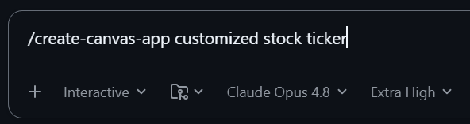
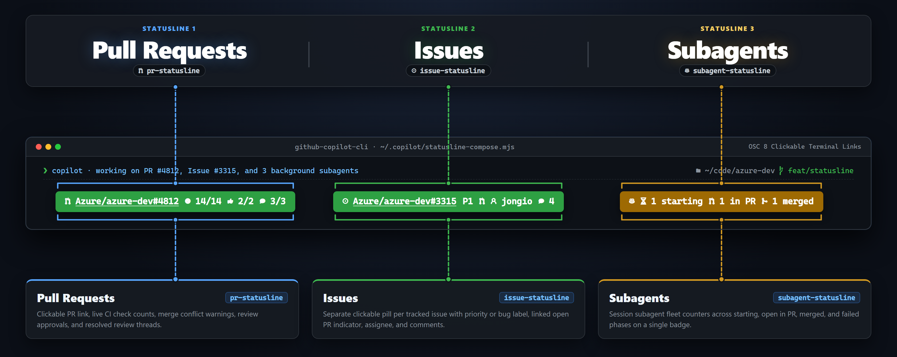
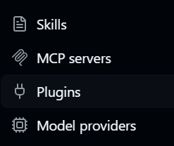
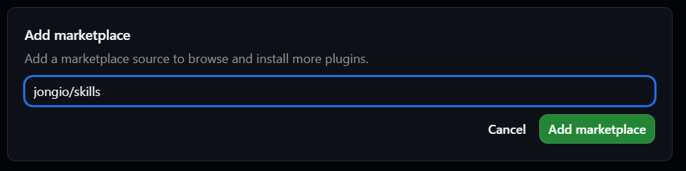
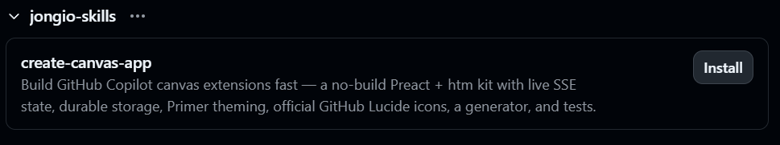
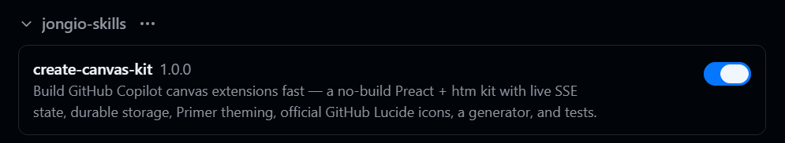

# jongio/skills

[](https://skills.sh/jongio/skills)

Jon Gallant's collection of skills for AI coding agents — works with
[GitHub Copilot](https://docs.github.com/copilot), Claude, Codex, and any agent
that supports the [`SKILL.md`](https://github.com/vercel-labs/skills) format. A
general-purpose monorepo: each skill lives in its own folder under
[`skills/`](skills/) and can be installed individually or all at once.

## Skills

| Skill | What it does |
|---|---|
| [`create-canvas-app`](skills/create-canvas-app/) | Build GitHub Copilot App canvas extensions fast — a no-build Preact + htm kit with live SSE state, durable storage, Primer theming, official GitHub Lucide icons, deep links into the app, a generator, and an installable skill. |
| [`create-gh-pages-site`](skills/create-gh-pages-site/) | Scaffold a working GitHub Pages site from a vetted template (static, Astro, React + Vite, Eleventy, Jekyll, or a skills catalog) into your current repo by default — injects the correct base path for the target repo, wires the official GitHub Actions Pages deploy workflow, sets the repo's Website link, and shows how to enable Pages. |
| [`create-skill`](skills/create-skill/) | Create and register a complete portable agent skill with focused instructions, deterministic tests, Vally evals, catalog metadata, and optional validated thumbnail art from a built-in or user-described provider. |
| [`create-skills-repo`](skills/create-skills-repo/) | Create or safely upgrade a cross-agent skills marketplace repository with every supported manifest, Vally, secure CI, Dependabot, a functional starter skill, and an optional GitHub Pages catalog. |
| [`repo-ready`](skills/repo-ready/) | Scaffold and maintain the standard community health files every GitHub repository needs (.gitignore, LICENSE, CONTRIBUTING, issue templates, CI workflows, dependabot, and more). Two modes: init (interview + scaffold) and update (scan for gaps). |
| [`naming-is-hard`](skills/naming-is-hard/) | Interactive naming assistant for projects, CLIs, and products. Profiles what you're building, generates diverse candidate names, learns your preferences as you react, and validates finalists against real availability (domains, GitHub, npm/PyPI/crates/RubyGems/NuGet, social handles) plus a trademark and existing-business screen. Every finalist lands a verdict: Deal Breaker, It's Complicated, or Perfect Match. |
| [`eli5`](skills/eli5/) | Explain the code, error, design, or idea already in context using plain language, a useful analogy, the proper grown-up terms, and an honest note about where the analogy stops working. |
| [`dns-doctor`](skills/dns-doctor/) | Audit DNS delegation, records, DNSSEC, CAA, web routing, TLS, CDN behavior, mail authentication, takeover exposure, and zone hygiene, then apply exact provider changes only after explicit user approval. |
| [`deps-doctor`](skills/deps-doctor/) | Audit, update, and secure dependencies across npm, pnpm, Yarn, pip, Poetry, uv, Go, Cargo, Bundler, Composer, NuGet, Maven, Gradle, Swift, pub, and Hex, plus Docker base images, GitHub Actions, Terraform, and dev container features. Ranks vulnerabilities by exploitation evidence, withholds releases too new to have been vetted, fixes breaking changes forward instead of rolling back, and never opens an empty dependency pull request. |
| [`git-tidy`](skills/git-tidy/) | Content-aware Git work triage across branches, worktrees, stashes, remote refs, tags, remotes, artifacts, ignored tracking, large blobs, and maintenance. Leads with plain decisions and concrete actions while exact proof stays available on demand; analysis is read-only and every action requires separate approval. |

A skill is invoked straight from the Copilot composer &mdash; here `create-canvas-app`
turns a one-line prompt into a working canvas:



## Copilot CLI Statusline Extensions

This plugin also ships three composable terminal statuslines for GitHub Copilot CLI under [`extensions/`](extensions/) (exposed to Agent Plugins 1.0 hosts via `com.github.copilot/extensions/`):

| Extension | What it shows |
|---|---|
| [`pr-statusline`](extensions/pr-statusline/) | Color-coded PR status pills in the Copilot CLI footer for every pull request the active session is working on across repositories and worktrees: clickable `owner/repo#number` OSC 8 links, CI check progress (`passed/total`), merge conflict alerts, review approvals, resolved review threads, and a purple `Merged` badge that dismisses on your next prompt. |
| [`issue-statusline`](extensions/issue-statusline/) | Separate clickable pill for each GitHub issue the active session is working on: priority or bug labels, linked open PR indicator, assignee handle, comment count, and a purple `Closed` badge that dismisses on your next prompt. |
| [`subagent-statusline`](extensions/subagent-statusline/) | Live session subagent counter pill (`starting`, `in PR`, `merged`, and `failed`) that turns purple when all subagent PRs merge and dismisses on your next prompt. |



Installing `statuslines@jongio-skills` (statuslines only) or `jongio-skills@jongio-skills` (all skills and statuslines) from the `jongio/skills` marketplace auto-registers the statuslines and opens an interactive checkbox picker on first session start (and adds `/statusline-setup` so you can toggle **Pull Requests**, **GitHub Issues**, and **Subagents** anytime), or you can run the standalone setup script:

```text
# Install just the statuslines (no skills) in Copilot CLI:
/plugin marketplace add jongio/skills
/plugin install statuslines@jongio-skills
```

```powershell
# Windows (PowerShell one-liner)
irm https://raw.githubusercontent.com/jongio/skills/main/install-statusline.ps1 | iex
```

```bash
# macOS & Linux (Bash one-liner)
curl -fsSL https://raw.githubusercontent.com/jongio/skills/main/install-statusline.sh | bash
```

## Install

### Option 1: Copilot Plugin Marketplace (Recommended)

`jongio/skills` plugs directly into the GitHub Copilot **plugin** system (works in both
the Copilot app and the [Copilot CLI](https://docs.github.com/copilot/how-tos/copilot-cli)).
The repo ships a root [`marketplace.json`](marketplace.json) and [`plugin.json`](plugin.json) so you can install the complete collection (all skills and statuslines) or pick individual skills:

```text
# 1. Register the marketplace once inside Copilot CLI:
/plugin marketplace add jongio/skills

# 2a. Install the entire collection (all skills + CLI statuslines):
/plugin install jongio-skills@jongio-skills

# 2b. Or install just the CLI statuslines (no skills):
/plugin install statuslines@jongio-skills

# 2c. Or install just one skill from the marketplace:
/plugin install create-canvas-app@jongio-skills
```

Or from your terminal shell:

```sh
copilot plugin marketplace add jongio/skills
copilot plugin marketplace browse jongio-skills
copilot plugin install jongio-skills@jongio-skills
# or just the CLI statuslines (no skills):
copilot plugin install statuslines@jongio-skills
# or a single skill:
copilot plugin install create-canvas-app@jongio-skills
```

**In the Copilot app** (no commands needed):

1. Open **Settings** and select **Plugins**.

   

2. Click **Install &#9662; &rarr; Add marketplace**, enter `jongio/skills`, and click **Add marketplace**.

   

3. The marketplace's skills appear grouped under **jongio-skills** &mdash; click **Install** on the one you want (or **jongio-skills** for the complete collection).

   

4. The skill installs and is enabled, ready to use right away.

   

### Option 2: Skills CLI (`npx skills`)

For hosts that use the standalone [`vercel-labs/skills`](https://github.com/vercel-labs/skills) CLI (`skills.sh`):

```sh
# List the skills available in this repo:
npx skills add jongio/skills --list

# Install one skill globally for GitHub Copilot:
npx skills add jongio/skills --skill create-canvas-app -g --agent github-copilot

# Install into the current project instead of globally (drop -g):
npx skills add jongio/skills --skill create-canvas-app

# Install every skill in the repo:
npx skills add jongio/skills --all
```

After any install, reload skills with `/skills reload` or start a new session.
Each skill is then available as `/<skill-name>` (e.g. `/create-canvas-app`).

### App and editor support

The repository keeps every skill under `skills/` and wraps that canonical
directory with the native manifests required by each supported host. No skill
content is copied between formats.

| Surface | Support | Install or discovery path |
|---|---|---|
| GitHub Copilot app | Marketplace and individual or complete plugin install | Open **Customize**, select **Plugins**, add `jongio/skills`, then install one skill or `jongio-skills`. |
| GitHub Copilot in Visual Studio Code | Agent Plugins 1.0 and marketplace install | Enable `chat.plugins.enabled`, run **Chat: Install Plugin From Source**, and enter `https://github.com/jongio/skills`. |
| GitHub Copilot CLI | Marketplace and direct plugin install | Run `copilot plugin marketplace add jongio/skills` or `copilot plugin install jongio/skills`. |
| Copilot coding agent and code review | Agent Skills in the target repository | Install selected skills into the target repository with `npx skills add jongio/skills`. |
| ChatGPT desktop and Codex CLI | Codex marketplace and skills-only plugin | Add `jongio/skills` as a marketplace. If using sparse paths, include `.agents/plugins`, `.codex-plugin`, and `skills`. |
| ChatGPT web and mobile | Public directory plugins only | A Git marketplace cannot enable these surfaces. Public availability requires review through the [OpenAI plugin submission portal](https://developers.openai.com/plugins/deploy/submission). |
| Codex IDE extension | Standalone Agent Skills only | The IDE extension does not support plugins. Install selected skills with `npx skills add jongio/skills --agent codex`. |
| Claude Code, including its Visual Studio Code and JetBrains integrations | Claude marketplace plugin | Run `/plugin marketplace add jongio/skills`, then `/plugin install jongio-skills@jongio-skills`. |
| Cursor | Agent Plugins 1.0 and Cursor marketplace | Install `https://github.com/jongio/skills` from **Customize**, or import the repository as a marketplace. |
| Gemini CLI and its editor companion | Gemini extension | Run `gemini extensions install https://github.com/jongio/skills`. Gemini Code Assist is a separate product and does not load Gemini CLI extensions. |
| Goose Desktop, Windsurf, Cline, Roo Code, and OpenCode | Native Agent Skills | Install selected skills with `npx skills add jongio/skills`; the installer places them in each host's supported skills directory. |

The root `plugin.json` follows
[Agent Plugins 1.0](https://agent-plugins.org/plugin-authors/manifest), which
is shared by GitHub Copilot in Visual Studio Code, Cursor, Codex, and other
compatible hosts. Vendor-specific manifests exist only where a host requires a
different discovery path:

```text
plugin.json                         Agent Plugins 1.0 package
marketplace.json                    GitHub Copilot marketplace
.agents/plugins/marketplace.json    Codex and ChatGPT desktop marketplace
.codex-plugin/plugin.json           Codex plugin compatibility manifest
.claude-plugin/marketplace.json     Claude Code marketplace
.claude-plugin/plugin.json          Claude Code plugin
.cursor-plugin/marketplace.json     Cursor marketplace
gemini-extension.json               Gemini CLI extension
skills/                             Canonical Agent Skills
```

## Dependency maintenance

Active development tooling uses Vally **0.18.0**, pinned in the shared CI tools
and each skill's manifest and lockfile. The active `create-skill` generator uses
the same pin. The `create-skills-repo` bundled authoring snapshot and its shared
Vally tooling also use 0.18.0 to preserve byte-for-byte authoring parity and
generated-skill compatibility. Intentional evaluation fixtures and unrelated
template dependencies retain their independent version snapshots.

Each independent npm root enforces `min-release-age=7` in its `.npmrc`;
Dependabot's npm entries use a seven-day cooldown. Use a supported npm release
that implements this setting. The Vally 0.18.0 migration was explicitly approved
as a one-time exception; no permanent release-age exclusions are configured.

Vally 0.18's preferred `agent_environment` key replaces the deprecated
`environment` alias in active eval specs. Fixture staging, scoring thresholds,
and CI's trial-level safety guards remain unchanged.

The site temporarily pins three compatible transitive security fixes through
scoped overrides: `astro`'s `http-cache-semantics` 4.3.0
([GHSA-ch52-4w7c-c8xp](https://github.com/advisories/GHSA-ch52-4w7c-c8xp)) and
`sharp` 0.35.5
([GHSA-wq5f-xc86-pv6w](https://github.com/advisories/GHSA-wq5f-xc86-pv6w)),
and `unifont`'s `undici` 8.10.2
([GHSA-w293-vg96-wgc3](https://github.com/advisories/GHSA-w293-vg96-wgc3)
and the related undici advisories). Remove each override when a parent upgrade's
resolved graph supplies a compatible patched version, then regenerate and audit
the lockfile. These overrides do not authorize unrelated bot-owned updates.

## Layout

```text
marketplace.json              GitHub Copilot marketplace
plugin.json                   Agent Plugins 1.0 package manifest
.agents/plugins/              Codex and ChatGPT desktop marketplace
.codex-plugin/                Codex compatibility manifest
.claude-plugin/               Claude Code plugin and marketplace
.cursor-plugin/               Cursor marketplace
gemini-extension.json         Gemini CLI extension
test/                         Cross-harness distribution parity tests
skills/
  create-canvas-app/          One self-contained skill
    SKILL.md                  Authoring contract the agent reads
    README.md                 Human docs for the skill
    references/               Lookup detail SKILL.md links to, to stay under 500 lines
    evals/                    Vally eval spec plus its fixtures
    test/                     Deterministic tests, run in CI for every skill
    kit/  scripts/  docs/     Skill-specific assets
docs/                         Specs, test plans, thumbnail prompts
site/                         Astro catalog published to GitHub Pages
.github/workflows/            skill-lint (every push), skill-eval (agent evals)
```

### Adding a skill

A skill is more than its folder: CI enforces that every skill is registered
everywhere the catalog advertises it. The root distribution test covers every
skill and host manifest. Skills with additional registration contracts enforce
them in local tests. On pull requests, `skill-lint.yml` runs Vally lint, strict
eval-spec lint, and deterministic tests for affected skills. Pushes to the
default branch cover every skill. The workflow always builds the catalog site.

1. `skills/<name>/` with `SKILL.md` (500-line ceiling; overflow goes to
   `references/`), `README.md`, `package.json`, `test/`, and `evals/<name>/eval.yaml`.
   Use `/create-skill <name>` to create and register this complete shape.
2. The skill table in this README.
3. `marketplace.json` and the `keywords` array in `plugin.json`.
4. `site/src/content/skills/<name>.md`, with `thumb:` pointing at
   `images/thumb-<name>.png`.
5. The `all=` matrix in `.github/workflows/skill-eval.yml`.
6. A tracked thumbnail at `skills/<name>/thumbnail.png`, generated from a
   prompt recorded in [`docs/thumbnail-prompts.md`](docs/thumbnail-prompts.md)
   and listed in [`site/public/images/IMAGES.md`](site/public/images/IMAGES.md).
   The site validates catalog mappings and generates ignored public copies
   before development and production builds.

Copy the newest skill rather than the oldest; it reflects the current conventions.

### Investigating nightly eval failures

Skill Eval remains limited to trusted scheduled and manual runs; pull requests
run model-free lint and deterministic tests. Model-backed runs use the owner's
Copilot allowance and require an approved scope before dispatch.

For a bounded manual investigation, select explicit skill ids or paths separated
by commas and a Vally `filter_tag`. The neutral `ci=targeted` tag selects the
six current regression scenarios rather than their complete suites:

```sh
gh workflow run skill-eval.yml --repo jongio/skills --ref <reviewed-ref> \
  -f skill=create-skill,dns-doctor,create-gh-pages-site \
  -f filter_tag=ci=targeted -f verbose=true
```

Runs retain five trials per stimulus, two workers and zero retries. `verbose`
defaults off and requires an explicitly filtered skill selection; opt in only
for reviewed, non-sensitive fixtures because agent answers appear in the job
log. No transcripts or environment-bearing artifacts are uploaded.

Every run prints normalized summary and failed-grader diagnostics, even when
the eval command fails. The pass gate still rejects execution errors and any
failed skill-invocation, diff-empty or tool-calls check; a high average prompt
score does not waive those checks.

## License

MIT — see [LICENSE](LICENSE).
