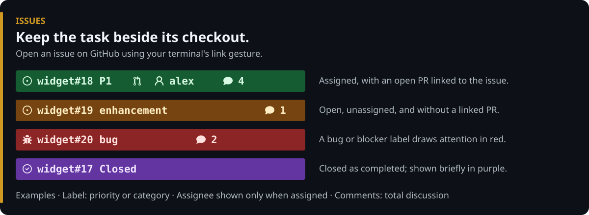
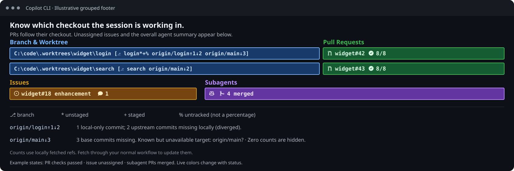

# Issue Statusline

A composable GitHub Copilot CLI status line that tracks **GitHub issues** the active session is working on, rendering a separate clickable pill for each issue with priority/type labels, linked-PR indicator, assignee, comment count, and a purple ` Closed` pill that dismisses on your next input. Composes with [`pr-statusline`](../pr-statusline), [`subagent-statusline`](../subagent-statusline), and [`worktree-statusline`](../worktree-statusline) via `~/.copilot/statusline-compose.mjs`.



With Branch and Worktree enabled, linked issues follow their PR on a checkout
row after its full-path/branch pill. Unassigned or ambiguous issues remain on
the unlabeled fallback row; issue numbers alone never determine a checkout.
See the [association rules](../worktree-statusline/README.md#association-rules).
Checkout pills also show labeled upstream/base divergence counts from locally
fetched refs; these are Git commit comparisons, not issue state or a percentage.
See the [divergence legend](../worktree-statusline/README.md#upstream-and-base-divergence).



## Install (Windows, macOS, and Linux)

### Option 1: Install as a Copilot Plugin or Interactive Script (Recommended)

Install via the `jongio/skills` Copilot plugin, or run a single command to choose **Pull Requests**, **GitHub Issues**, **Subagents**, and/or **Branch and Worktree**:

**Copilot CLI Plugin:**

```bash
copilot plugin install jongio/skills
```

**Windows (PowerShell):**

```powershell
# One-liner (no clone required)
irm https://raw.githubusercontent.com/jongio/skills/main/install-statusline.ps1 | iex

# Or from a clone
.\install-statusline.ps1
```

**macOS & Linux (Bash / Zsh):**

```bash
# One-liner (no clone required)
curl -fsSL https://raw.githubusercontent.com/jongio/skills/main/install-statusline.sh | bash

# Or from a clone
./install-statusline.sh
```

### Option 2: Ask Copilot

```text
set up the copilot statusline from jongio/skills and ask me which of PRs, issues, subagents, and worktrees I want
```

### Option 3: Standalone extension installer

```powershell
# Windows (PowerShell)
& .\extensions\issue-statusline\install.ps1
```

```bash
# macOS & Linux (Bash)
./extensions/issue-statusline/install.sh
```

## What appears in each pill

- `  Azure/azure-dev#3315 P1   jongio  4 ` (Green: assigned and has a linked open PR)
- `  Azure/azure-dev#3322 enhancement  unassigned  1 ` (Amber: open and unassigned)
- `  Azure/azure-dev#3318 bug  2 ` (Red: bug or blocker label)
- `  Azure/azure-dev#3314 Closed ` (Purple: closed as completed during this session; dismisses on your next prompt)

- **Separate clickable pill per issue:** Every tracked issue renders in its own pill with a fully-qualified `owner/repo#number` OSC 8 link.
- **Auto-hides when no issues are active:** Outputs nothing (0 lines) when the session is not working on any issues.
- **Icons & Metadata:**
  - `` (`U+F41B`): Open issue
  - `` (`U+F188`): Bug / security / critical issue (red pill)
  - `` (`U+E726`): Linked pull request indicator (green pill)
  - ` login` (`U+F415`): Assignee
  - ` N` (`U+F075`): Comment count
  - ` Closed` (`U+F41D`): Closed as completed during the session (purple pill, dismissed on your next prompt)

## Session commands

With the SDK extension loaded, use `/session-issues list`, `/session-issues add owner/repo#123`, `/session-issues remove owner/repo#123`, or `/session-issues clear` to manage this session's tracked issues.

Only explicit enrollment and concrete issue work (create/edit/comment/close/reopen/
develop or targeted API/MCP writes) create pills.
Message references, attachments, workspace/branch names, read-only lookups, and list/search
results do not. Explicitly add an issue when taking on read-only review or monitoring.
The `session-statusline` skill exposes these controls in the `jongio-skills` plugin.
Clearing changes tracking only; it does not close issues or disable components.

## Validate

```powershell
node --test .\extensions\issue-statusline\test\smoke.test.mjs
```
