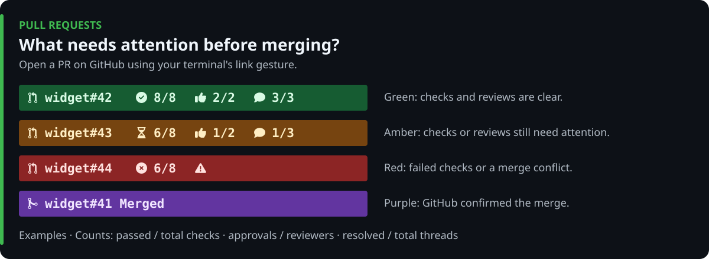

# PR Statusline

A composable GitHub Copilot CLI status line that tracks the pull requests **this session** is actively working on across repositories and worktrees, rendering live, color-coded status pills with fully-qualified clickable web links (`owner/repo#number`), CI check progress (`passed/total`), review approvals (`approved/requested`), and review comment resolution (`resolved/total`). Composes with [`issue-statusline`](../issue-statusline), [`subagent-statusline`](../subagent-statusline), and [`worktree-statusline`](../worktree-statusline) via `~/.copilot/statusline-compose.mjs`.




## Compact subagent PRs

With both PR and subagent statuslines enabled, positively identified
subagent-only PRs contribute to one overall subagent summary instead of
individual detailed PR pills. PRs directly worked on by the main session remain
detailed, even if an agent also references them. Unknown ownership, including
older cache entries without provable provenance, stays detailed. Disabling or
dismissing the subagent summary restores those PR details; no arbitrary item
limit drops PRs or issues. Standalone PR rendering remains detailed.

Enabling the worktree statusline also groups PRs and linked issues by checkout
on separate rows. Its branch pill compares the configured upstream (`↑` local
only, `↓` missing locally) and the matched PR's target branch (`↓` missing base
commits), using locally fetched refs. The target repository is respected for
fork PRs; ambiguous or unavailable comparisons are not reported as current.
See [divergence indicators](../worktree-statusline/README.md#upstream-and-base-divergence)
and [association rules](../worktree-statusline/README.md#association-rules).

## Install (Windows, macOS, and Linux)

### Option 1: Install as a Copilot Plugin or Interactive Script (Recommended)

Install via the `jongio/skills` Copilot plugin (auto-registers the statuslines on session start), or run the interactive setup script to choose **Pull Requests**, **GitHub Issues**, **Subagents**, and/or **Branch and Worktree**:

**Copilot CLI Plugin:**

```bash
copilot plugin install jongio/skills
```

**Windows (PowerShell):**

```powershell
# One-liner (no clone required)
irm https://raw.githubusercontent.com/jongio/skills/main/install-statusline.ps1 | iex

# Or from a clone
.\install-statusline.ps1
```

**macOS & Linux (Bash / Zsh):**

```bash
# One-liner (no clone required)
curl -fsSL https://raw.githubusercontent.com/jongio/skills/main/install-statusline.sh | bash

# Or from a clone
./install-statusline.sh
```

**Cross-platform Node.js CLI (with optional non-interactive flags):**

```bash
node ./scripts/setup-statusline.mjs
node ./scripts/setup-statusline.mjs --prs --issues --subagents
node ./scripts/setup-statusline.mjs --all
```

### Option 2: Ask Copilot (App or CLI)

```text
set up the copilot statusline from jongio/skills and ask me which of PRs, issues, subagents, and worktrees I want
```

### Option 3: Standalone extension installer

```powershell
# Windows (PowerShell)
& .\extensions\pr-statusline\install.ps1
```

```bash
# macOS & Linux (Bash)
./extensions/pr-statusline/install.sh
```

`setup-statusline.mjs` and the installers copy runtime files listed in `scripts/setup-statusline.mjs`'s `EXTENSION_CATALOG` into `$COPILOT_HOME/extensions/<id>/` (default `~/.copilot`). PR installs include sibling runtime dependencies because the unified SDK entry point exposes their commands; only your selected footer items are enabled. Setup installs the shared `statusline-compose.mjs`, saves selections to `statusline-config.json`, and configures `statusLine` (`padding: 0`, `refreshInterval: 5`) and `footer.showCustom` in `settings.json`.

### Option 4: Manual setup (macOS / Linux / Windows)

1. Copy every runtime file in `EXTENSION_CATALOG` for all four packages to `~/.copilot/extensions/<id>/`, preserving package directories. This includes the unified PR entry point's sibling dependencies. Copy the shared `extensions/state-lock.mjs` to `~/.copilot/extensions/state-lock.mjs` and `extensions/pr-statusline/compose.mjs` to `~/.copilot/statusline-compose.mjs`.
2. Add the following to `~/.copilot/settings.json`:

```json
{
  "statusLine": {
    "type": "command",
    "command": "node \"/Users/you/.copilot/statusline-compose.mjs\"",
    "padding": 0,
    "refreshInterval": 5
  },
  "footer": {
    "showCustom": true
  }
}
```

3. To enable only PR pills, create `~/.copilot/statusline-config.json`:

```json
{
  "version": 1,
  "enabled": ["pr-statusline"],
  "iconMode": "auto"
}
```

## What appears in each pill

Using `Azure/azure-dev` as an example checkout:

- `  Azure/azure-dev#4812  14/14  2/2  3/3 ` (Green: all checks passing, approvals granted, threads resolved)
- `  Azure/azure-dev#4815  6/14  1/2  1/4 ` (Amber: checks running or reviews/threads pending)
- `  Azure/azure-dev#4819  11/14   0/2  0/3 ` (Red: checks failing or merge conflict)
- `  Azure/azure-dev#4810 Merged ` (Purple: merged during this session; dismisses on your next prompt)

- **Fully-qualified clickable links:** Every pill includes an OSC 8 hyperlink (`Ctrl+click` or `Cmd+click`) on `owner/repo#number` that opens the pull request web page directly on GitHub.
- **Zero-line auto-hide:** When a session has no tracked open PRs (or after merged PRs are dismissed on your next input), `render.mjs` outputs nothing and `padding: 0` ensures the status line takes **zero rows**.
- **Single-line compact pills:** Each pill renders on a single terminal row with horizontal padding so the statusline sits flush below the CLI status bar with no blank lines above or below.

### Nerd Font Icons & Metrics (`x/y`)

| Token | Meaning |
| --- | --- |
| `` (`U+E726`) | Open pull request (`nf-dev-git_pull_request`) |
| ` Merged` (`U+E727`) | Pull request merged (`nf-dev-git_merge`) |
| `` (`U+F4DD`) | Draft pull request (`nf-oct-git_pull_request_draft`) |
| ` x/y` (`U+F058`) | All checks completed with none failing (`x` passed / `y` total, including required branch-protection checks waiting to report) |
| ` x/y` (`U+F252`) | Checks currently running or queued (`x` passed so far / `y` total); `(n failed)` appears if other checks have completed with failures |
| ` x/y` (`U+F057`) | No checks are active and one or more checks failed (`x` passed / `y` total) |
| ` x/y` (`U+F164`) | Review approvals received (`x`) out of total reviewers requested or opinionated (`y`) |
| ` x/y` (`U+F075`) | Review comment threads resolved (`x`) out of total review threads (`y`) |
| `` (`U+F071`) | Merge conflicts (`mergeStateStatus === "DIRTY"`) |
| `` (`U+F440`) | Changes requested (`reviewDecision === "CHANGES_REQUESTED"`) |

### Attention-level badge colors

- **Green (All Clear):** All checks passing, no conflicts, and all review threads resolved (` #4812  14/14  2/2  3/3`).
- **Amber (In Progress / Needs Attention):** Checks are running or queued (``), including reruns after failure, approvals are still pending (` 1/2`), or review threads remain unresolved (` 2/4`). Active CI takes precedence over completed check failures; a mixed result shows progress plus `(n failed)` without implying the rerun has succeeded.
- **Red (Critical):** CI has no active checks and one or more failed (``), the PR has merge conflicts (``), or changes were requested (``). Conflicts and requested changes remain red even while CI is running.
- **Purple (Merged):** A merged PR remains visible until the next real user message
  after this session detects the merge, then disappears. GitHub's merge time and
  later cache polls don't move that first-observed boundary. Scheduled prompts,
  skill injections and subagent messages don't dismiss it. Older merged caches
  without an observation time conservatively start a fresh boundary on first
  load. Dismissal survives collector saves; explicit re-add/reopen starts a new
  tracking revision.
- **Slate (Neutral):** Draft PR (``).

## How PRs are discovered and refreshed

1. **Session-scoped transcript tailing (`tracker.mjs`):**
   `render.mjs` incrementally reads new bytes from the active session's `events.jsonl` transcript (from a persisted `transcriptOffset` in `$COPILOT_HOME/pr-statusline/<session_id>.json`) plus `workspace.yaml`. It extracts PRs from:
   - Explicit `session_prs` enrollment when this session takes on implementation, review, repair, or active monitoring
   - Concrete `gh pr` work (`checkout`, `create`, `edit`, `review`, `comment`, `merge`, `close`, `reopen`, `ready`), explicit-method REST writes to a targeted PR, and GitHub MCP PR write tools
   It does not enroll from message references, attachments, workspace/branch names, remote payload metadata,
   schedules, task prompts/results, `view`/`diff`/`checks`, API/MCP reads,
   `list`/`search` output, examples, or other sessions' transcripts. Explicitly
   add read-only review/watch targets. Existing tracked PRs still refresh normally.
   On upgrade, legacy reference-only caches are rebuilt from active evidence.
   A successful write without an explicit selector can enroll its target when
   the entire CLI result is one PR URL (including a comment fragment). Ambiguous
   output, compound commands, failed operations, and lookups cannot use this fallback.
2. **Single-query GraphQL status + shared cache (`github.mjs`):**
   Live PR status is fetched via `gh api graphql` (falling back across secondary logged-in `gh auth` accounts when a PR lives in another organization) and cached across sessions in `$COPILOT_HOME/pr-statusline/pr-cache.json` (20s TTL while checks are running, including mixed running/failed checks, 45s TTL when settled, with in-flight deduplication locks). A restarted check's active status takes precedence over a leftover conclusion; the pill changes on the next successful refresh, not optimistically when a rerun command is issued. It does **not** use Copilot AI model requests or touch Copilot's internal databases.
3. **Automatic cleanup & manual controls:**
   Closed PRs are removed automatically. Merged PRs remain until the next real user message after this session detects the merge. When the SDK extension (`extension.mjs`) is loaded, you can also manage the list manually:

```text
/session-prs list
/session-prs add Azure/azure-dev#4812
/session-prs remove Azure/azure-dev#4812
/session-prs clear
```

## Session recovery and setup

The unified SDK extension provides a separate command from Copilot's built-in
`/statusline` and `/footer`, which are left untouched:

| Command | Effect |
| --- | --- |
| `/session-statusline refresh` | Immediately re-query tracked PRs, issues, agent-linked PRs, and Git checkout/worktree data, bypassing status TTLs and applicable shared/in-flight caches. Keeps tracking and component selections; reports incomplete refreshes and individual failures explicitly. |
| `/session-statusline clear` | Dismiss this session's current PR, issue, subagent, and worktree entries. Does not delete transcripts, affect other sessions, or change component selections. |
| `/session-statusline setup` | Open the component picker. Optional selections such as `all`, `none`, or `prs issues` also work. `/statusline-setup` remains a compatibility alias. |

The `session-statusline` skill in the `jongio-skills` plugin maps natural-language
requests such as "clear the footer pills" to the session-bound `session_statusline`,
`session_prs`, `session_issues`, and `session_subagents` tools. Per-component clear
is available through `/session-prs clear`, `/session-issues clear`, and
`/session-subagents clear`; `/session-subagents remove <agent-id>` dismisses one
agent without stopping it. Use `/session-subagents list` to find tracked IDs.

**Clear is not refresh or hide.** Clear saves a session-specific replay boundary,
so old transcript events, unchanged workspace metadata, and collector saves do
not immediately restore dismissed entries. New activity after that boundary can
track entries again, including previously cleared references. A new successful
shell command or directory context can restore the current worktree entry.
Root and subagent directory context is retained for resolving new relative
commands without making those dismissed directories visible again.
Re-indexing restarts from that clear-time context, not the latest directory.
If bounded worktree replay is still catching up, clear reports a retry instead
of discarding unread directory changes or committing a dismissal boundary.
Each component retains its own consumed transcript cursor; validation of the
worktree EOF does not skip records that other components have not processed.
Worktree replay excludes all directory events included in its baseline without
advancing the PR, issue, or subagent activity boundaries.
Existing per-component list/add/remove/clear commands remain available.

Use **setup** to hide a component without dismissing its tracked items. Hidden
components can be enabled again later; hiding does not clear their history.
Refresh keeps entries tracked even when GitHub reports them closed or missing;
normal subsequent footer updates still apply the existing lifecycle rules.
Remote observations are applied to the latest locked tracking state, preserving
activity and dismissals recorded while those queries run.
Git comparisons use local refs; refresh does not fetch remote Git branches.

After installing updated runtime files, **restart Copilot** to reload an
already-running SDK collector and register the new command. Clear and refresh
themselves require no restart once the updated extension is loaded. Recovery
commands are registered by the unified PR SDK entry point; PR installs include
its sibling runtime dependencies even when those footer components are hidden.
Legacy tracking is rebuilt from concrete transcript activity on first load;
previously pinned read-only targets without that evidence may need one explicit
re-add. Workspace and remote metadata alone no longer enroll targets.
Legacy migration reads the complete available history in 1 MiB I/O chunks,
reassembling records that cross chunk boundaries. Saved dismissals survive
already-consumed reopen history; genuinely new reopen or explicit add requests
can resume tracking.
State writes and worktree replay use per-session, cross-process locks. A lock
timeout reports its exact path rather than overwriting potentially active state.
If a process crashed while holding a lock, stop the session's collectors before
removing only that reported `.lock` directory, then restart Copilot.

## Validate

```powershell
node --test .\extensions\pr-statusline\test\smoke.test.mjs
node --test .\extensions\worktree-statusline\test\entrypoints.test.mjs
```

To disable the custom footer at any time, run `copilot config footer.showCustom off`.
