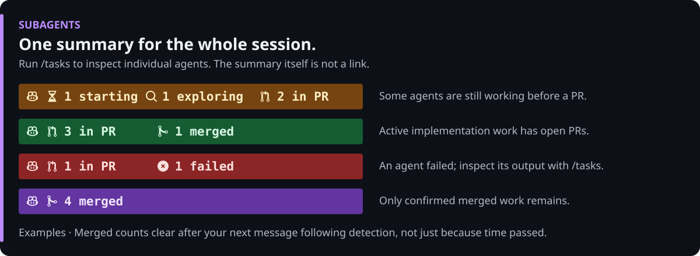

# Subagent Statusline

A composable GitHub Copilot CLI status line that tracks **subagent state counts** (`starting`, `exploring`, `in PR`, `merged`, and `failed`) for the active session. The padded summary has no terminal hyperlink; use `/tasks` to inspect individual agents. Coexists with [`pr-statusline`](../pr-statusline) and [`issue-statusline`](../issue-statusline) via `~/.copilot/statusline-compose.mjs`, or appears once on the unlabeled summary row when [`worktree-statusline`](../worktree-statusline) groups checkouts.




The summary is not repeated per checkout. PR details owned only by active
subagents can collapse into these counts, while root-worked and unknown-owner
PRs remain detailed. See the [worktree association rules](../worktree-statusline/README.md#association-rules).
Each checkout can independently show its upstream/base divergence even when
subagent-only PR details are compacted. These commit counts are separate from
the overall agent counts and use locally fetched refs.
See the [divergence legend](../worktree-statusline/README.md#upstream-and-base-divergence).

## Install (Windows, macOS, and Linux)

### Option 1: Install as a Copilot Plugin or Interactive Script (Recommended)

Install via the `jongio/skills` Copilot plugin, or run a single command to choose **Pull Requests**, **GitHub Issues**, **Subagents**, and/or **Branch and Worktree**:

**Copilot CLI Plugin:**

```bash
copilot plugin install jongio/skills
```

**Windows (PowerShell):**

```powershell
# One-liner (no clone required)
irm https://raw.githubusercontent.com/jongio/skills/main/install-statusline.ps1 | iex

# Or from a clone
.\install-statusline.ps1
```

**macOS & Linux (Bash / Zsh):**

```bash
# One-liner (no clone required)
curl -fsSL https://raw.githubusercontent.com/jongio/skills/main/install-statusline.sh | bash

# Or from a clone
./install-statusline.sh
```

### Option 2: Ask Copilot

```text
set up the copilot statusline from jongio/skills and ask me which of PRs, issues, subagents, and worktrees I want
```

### Option 3: Standalone extension installer

```powershell
# Windows (PowerShell)
& .\extensions\subagent-statusline\install.ps1
```

```bash
# macOS & Linux (Bash)
./extensions/subagent-statusline/install.sh
```

`setup-statusline.mjs` and the standalone installers copy the extension into `$HOME/.copilot/extensions/subagent-statusline`, configure the shared `~/.copilot/statusline-compose.mjs` compositor, merge `"subagent-statusline"` into `~/.copilot/statusline-config.json`, and enable `footer.showCustom` in `~/.copilot/settings.json`.

## What appears in the pill

- `   1 starting  1 exploring  1 in PR  1 merged ` (Amber: subagents actively starting or exploring)
- `   3 in PR  1 merged ` (Amber: active subagent PRs remain in progress)
- `   1 in PR  1 failed ` (Red: at least one subagent exited with an error)
- `   4 merged ` (Purple: all subagent PRs merged; dismisses on your next prompt)

- **Auto-hides when idle:** Outputs nothing (0 lines) when the session has no active or merged subagents.
- **Inspection:** Run `/tasks` in the Copilot CLI console for individual subagent timelines. With the SDK extension loaded, `/session-subagents list` shows counts and tracked IDs, `/session-subagents remove <agent-id>` dismisses one agent, and `/session-subagents clear` dismisses the tracked summary. These controls do not stop agents; the `session-statusline` skill exposes them through `session_subagents`.
- **Session ownership:** Only actual task launches and subagent start events in this session enroll agents. Reading or listing agents and mentioning their IDs do not. Task prompts/results and PR lookups cannot create PR associations; concrete PR work can. Manual removal survives transcript re-indexing.
- **Checkout targets:** Numeric/URL selectors support flags, quoted values, the `co` alias, and explicit repository hosts. Local branch/worktree option values are never treated as PR numbers. A command that changes directories cannot inherit the parent's repository without an explicit repository or PR URL; unresolved branch-name selectors require a resolved success URL or explicit tracking.
- **State lifecycle:**
  - ` N starting` (`U+F252`): Implementation subagents currently running that have not opened a PR yet.
  - ` N exploring` (`U+F422` / Unicode `◎`): Read-only `explore` and `research` subagents currently investigating.
  - ` N in PR` (`U+E726`): Subagents that have opened or worked on an open pull request.
  - ` N merged` (`U+E727`): Subagents whose pull requests have merged.
  - ` N failed` (`U+F057`): Subagents that failed with an error.
- **Merged dismissal:** Each settled contribution remains visible until the next
  real user message after its settlement is detected. Other active agents don't
  keep old merged counts visible. Active PRs and ongoing agents remain; an agent
  still running after its merged count is dismissed returns to its running count.
  Cache polls don't reset the observation time. Legacy settled caches without a
  reliable boundary get one fresh observation boundary on load.

## Validate

```powershell
node --test .\extensions\subagent-statusline\test\smoke.test.mjs
```
